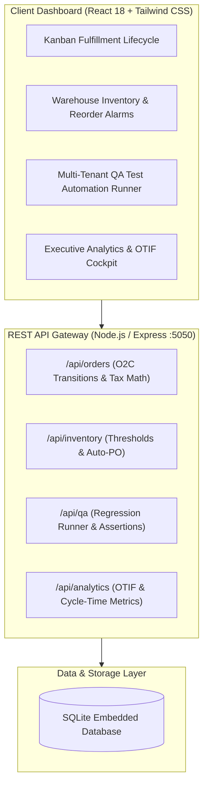
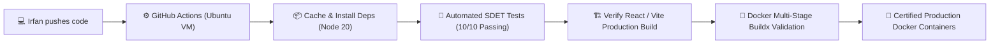

# 📦 AuraSupply — Enterprise Supply Chain Fulfillment Portal & QA Automation Engine

[](https://github.com/irfnfrdaus/aurasupply-fulfillment-portal/actions)
[](https://www.docker.com/)
[](https://github.com/irfnfrdaus/aurasupply-fulfillment-portal)
[](https://react.dev/)
[](https://nodejs.org/)
[](https://tailwindcss.com/)
[](https://www.sqlite.org/)
[](LICENSE)

**AuraSupply** is an enterprise-grade B2B Supply Chain & Order Fulfillment platform featuring an integrated **Multi-Tenant QA Test Automation & Compliance Engine**.

Directly inspired by 8 months of enterprise quality assurance at **Hilti Asia IT Services** across 30 enterprise cloud tenants (**SAP S/4HANA & SAP Business ByDesign**), AuraSupply simulates real-time Order-to-Cash (O2C) lifecycles, warehouse threshold alarms, and automated regression test execution with verifiable cycle-time reduction metrics.

---

## 🏗️ System Architecture



---

## ✨ Key Enterprise Capabilities

### 1. 🔄 Multi-Stage Order Fulfillment Lifecycle (Kanban & Table)
* **Realistic enterprise progression:**
  ```text
  [Quote Draft] ➔ [PO Approved] ➔ [Pick & Pack] ➔ [In Transit] ➔ [Delivered] ➔ [Invoiced & Paid]
  ```
* Real-time calculation of Malaysian **8% SST compliance tax** on all enterprise line items.
* Live tracking number generation and carrier allocation (`DHL Express`, `FedEx Global`, `Line Clear Logistics`, `Direct Fleet`).
* Support for high-priority corporate accounts (PETRONAS, Inari Amertron, TNB, Gamuda, Hilti).

### 2. 🏭 Warehouse & Inventory Reorder Threshold Engine
* Multi-warehouse allocation across Malaysian industrial hubs:
  * **WH-KUL-01:** Shah Alam Central Distribution Center
  * **WH-PEN-02:** Penang North High-Tech Hub
  * **WH-JHB-03:** Pasir Gudang South DC
* Dynamic visual threshold indicators: `In Stock`, `Low Stock Alert`, and `Critical Depletion`.
* **1-Click Auto-Requisition PO Generation** (`+50 Units Restock`) to prevent supply chain stockouts.

### 3. 🧪 ⭐ The Showstopper: Multi-Tenant QA Test Automation Runner
Modeled after enterprise post-upgrade regression testing at **Hilti Asia IT Services**:
* **Target Tenant Selection:** Partition tests across `Tenant 01 - APAC`, `Tenant 02 - EMEA`, and `Tenant 03 - AMER`.
* **Automated Regression Assertions:**
  * ✅ Tax formula accuracy across active orders.
  * ✅ Inventory allocation and stock reservation integrity.
  * ✅ SLA lead-time and carrier route validation.
  * ✅ Relational foreign key and schema drift detection.
* **Quantifiable Efficiency:** Demonstrates automated test execution in **< 1.4 seconds** compared to manual ~10 minutes per tenant (**>78% cycle-time reduction**).

### 4. 📊 Executive Analytics & SLA Compliance Cockpit
* **OTIF (On-Time In-Full)** compliance tracking (96.8% benchmark).
* Revenue pipeline vs. fulfilled/invoiced cash flows.
* Stage-by-stage order distribution analytics.

---

## 🚀 Quick Start (60 Seconds)

### Prerequisites
* **Node.js** (v18 or higher) — [nodejs.org](https://nodejs.org/)

### Windows (1-Click Launch)
Double-click **`run_aurasupply.bat`**.  
The script automatically:
1. Initializes and seeds the SQLite database.
2. Starts the server on port `5050`.
3. Opens your default web browser to `http://localhost:5050`.

To stop the server anytime, double-click **`Stop_AuraSupply.bat`**.

---

### Manual Setup (macOS / Linux / Windows)

```bash
# 1. Clone repository
git clone https://github.com/irfnfrdaus/aurasupply-fulfillment-portal.git
cd aurasupply-fulfillment-portal

# 2. Install dependencies
cd server && npm install
cd ../client && npm install

# 3. Seed database
cd ../server
node seed.js

# 4. Build frontend
cd ../client
npm run build

# 5. Start unified application
cd ../server
node index.js
```

Open **`http://localhost:5050`** in your browser.

---

## 🐳 DevOps & SDET CI/CD Pipeline

AuraSupply is architected with modern cloud-native DevOps principles and automated quality gates:



### 1. 🧪 Automated SDET API Quality Gate
Execute the comprehensive automated test suite verifying lifecycle state machines, SST calculations, and negative test cases:
```bash
cd server
npm test
```
* **10/10 Tests Passed in <1.2 seconds:**
  - `GET /api/health` — System health check & online status
  - `GET /api/orders` — Enterprise order list retrieval with line item mapping
  - `POST /api/orders (Negative)` — Rejects missing fields with 400 Bad Request
  - `POST /api/orders (Positive)` — Auto-generates `ORD-2026-xxx` with 8% SST calculation
  - `PATCH /api/orders/:id/status (Negative)` — Blocks illegal state transitions with 400 Bad Request
  - `PATCH /api/orders/:id/status (Positive)` — Advances state to `PO Approved`
  - `GET /api/inventory` — Verifies warehouse SKUs & stock depletion
  - `GET /api/analytics/dashboard` — Validates OTIF fulfillment metrics
  - `GET /api/qa/runs` & `POST /api/qa/execute` — Regression runner execution

### 2. 🐳 1-Click Multi-Container Deployment (Docker Compose)
Spin up the entire enterprise architecture (Express API + Nginx Static Server + SQLite) with a single command:
```bash
docker compose up --build
```
* **`aurasupply-server`**: Express REST API on Alpine Linux with built-in health check probes.
* **`aurasupply-client`**: Multi-stage production build served via **Nginx Reverse Proxy** on port 80/5173.

---

## 📁 Repository Structure

```
aurasupply-fulfillment-portal/
├── .github/
│   └── workflows/
│       └── ci.yml                      # GitHub Actions CI/CD Quality Gate Pipeline
├── client/                             # Frontend (React 18, Tailwind CSS, Vite)
│   ├── src/                            # Components, state & UI views
│   ├── nginx.conf                      # High-performance Nginx Reverse Proxy config
│   ├── Dockerfile                      # Multi-stage production container build
│   └── vite.config.js
├── server/                             # Backend REST API & QA Engine
│   ├── routes/                         # Orders, inventory, QA & analytics
│   ├── test/
│   │   └── api.test.js                 # SDET Automated API Quality Gate test suite
│   ├── database.js                     # SQLite connector & schema
│   ├── seed.js                         # Enterprise sample data seeder
│   ├── Dockerfile                      # Node 20 Alpine Linux production image
│   └── index.js                        # Unified API server (:5050)
├── docker-compose.yml                  # Multi-container orchestration & networking
├── run_aurasupply.bat                  # 1-Click Windows launcher
├── Stop_AuraSupply.bat                 # 1-Click Windows shutdown
├── LICENSE                             # MIT License
└── README.md
```

---

## 📄 License

Distributed under the **MIT License**. See `LICENSE` for more information.

---

**Developed with ❤️ by [Muhammad Irfan Firdaus](https://github.com/irfnfrdaus)**  
*UTP Big Data Analytics | Minor in Financial Management | Ex-IT QA Automation Intern at Hilti Asia IT Services*
